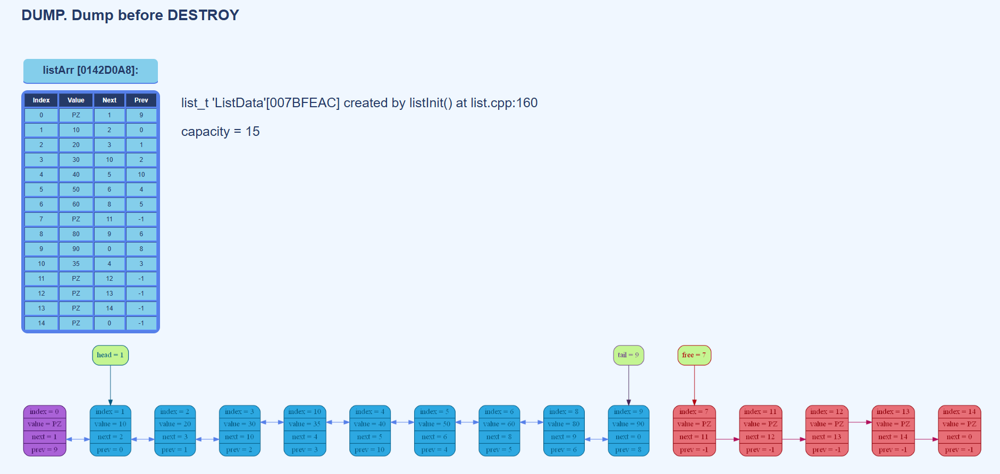

# Двусвязный список

Проект реализует двусвязный список с удобным сервисом графической отладки.
Проект написан на языке программирования СИ.
## Автор: Екатерина Краева
## Ментор: Павел Тараканов

## Преимущество
Упор в проекте делался на удобство debug-системы.
```
С красивыми логами дебажить приятно,
Где спрятался баг — сразу понятно!
```

## Компиляция и запуск
```
g++ -g -Wshadow -Winit-self -Wredundant-decls -Wcast-align -Wundef -Wfloat-equal -Winline -Wunreachable-code -Wmissing-declarations -Wmissing-include-dirs -Wswitch-enum -Wswitch-default -Weffc++ -Wmain -Wextra -Wall -g -pipe -fexceptions -Wcast-qual -Wconversion -Wctor-dtor-privacy -Wempty-body -Wformat-security -Wformat=2 -Wignored-qualifiers -Wlogical-op -Wno-missing-field-initializers -Wnon-virtual-dtor -Woverloaded-virtual -Wpointer-arith -Wsign-promo -Wstack-usage=8192 -Wstrict-aliasing -Wstrict-null-sentinel -Wtype-limits -Wwrite-strings -Werror=vla -D_DEBUG -D_EJUDGE_CLIENT_SIDE -DLIST_DEBUG list.cpp -o list.exe
```
```
./list.exe 3
```

## Структура
|Файл|Значение|
|:-|:-|
|list.h|структуры, константы, макросы и прототипы|
|list.cpp|Функции инициализации, добавления, удаления, уничтожения списка, тесты|
|verify.cpp|Функция верификации|
|graphics.cpp|Функции, связанные с формированием картинки для лога|
|formLogs.cpp|Формирование лог-файла в формате html|
|style.css|Стили log.html|

## Структура списка

Поля элемента массива:
- value — значение элемента.
- next — индекс следующего элемента.
- prev — индекс предыдущего элемента
```
struct listArrElem {

    list_elem_t value;
    list_elem_t next;
    list_elem_t prev;
};

struct list_t {

    size_t capacity;
    listArrElem* listArr;

    size_t head;
    size_t tail;
    size_t free;

    #ifdef LIST_DEBUG
        debugList_t debugInfo;
        ListVerifyLevel verifyLevel;
        FILE* logFilePtr;
    #endif
};
```
## Служебный элемент

Ячейка массива с индексом 0 является фиктивным элементом. Она используется для организации связей списка.

## Свободные элементы

Свободные ячейки организованы в отдельную цепочку.
Для свободного элемента:
- value = LIST_POISON.
- prev = -1.
- next содержит индекс следующей свободной ячейки

Поле free указывает на начало этой цепочки.

## Возможности списка

- Добавление элемента после переданного индекса
- Удаление элемента по индексу

## Уровни верификации

Список проверяется функцией-верификатором.
Работает только в режиме LIST_DEBUG
Уровни верификации:
```
enum ListVerifyLevel {
    VERIFY_OFF = 0,
    VERIFY_LIGHT = 1,
    VERIFY_MEDIUM = 2,
    VERIFY_FULL = 3
};
```
Уровень верификации получаются как консольный параметр.

|Уровень верификации|Значение|
|:-|:-|
|VERIFY_OFF|верификация отключена|
|VERIFY_LIGHT|Базовая проверка полей структуры|
|VERIFY_MEDIUM|Базовые проверки и проверка служебной ячейки|
|VERIFY_FULL|Полная проверка активной и свободной цепочек|

## Логи
```
log.html
```
HTML-дамп содержит:
- Информацию о структуре list_t
- Адрес списка и массива элементов
- Название файла и функции создания
- Вместимость массива
- Таблицу элементов
- Графическое представление списка

Лог файл открывается автоматически после компиляции в режиме ```-LIST_DEBUG``` и запуска.

Графическая реализация использует библиотеку ```Graphviz```.

Документация: https://www.graphviz.org/documentation/

Используемый гайд: https://lib.custis.ru/Graphviz

Лог каждого запуска хранится в отдельной папке вместе с используемыми там картинками.

Картинки создаются командой ```dot graph.txt -Tpng -o graph1.png``` через ```system```.

## Пример лога


